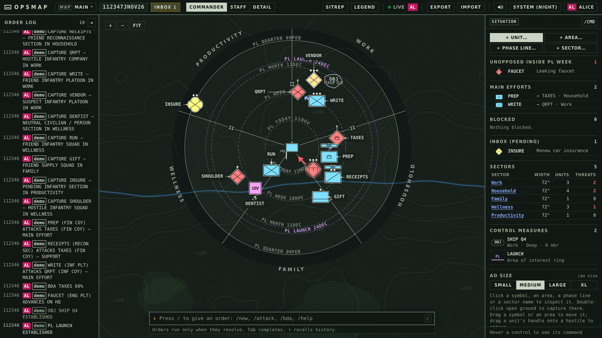
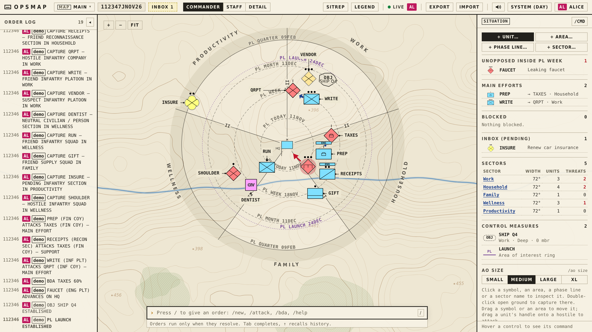

# opsmap

A personal operations map. Your tasks, problems, people and places are drawn as APP-6 / MIL-STD-2525 symbols on a tactical map. You are the HQ at the center, and the center is today. The rings around it are phase lines in time: today, this week, this month, this quarter. At 0400 each day the map runs its morning turn, and each problem with a due date moves in toward HQ as that date gets closer.



## Features

- Distance from HQ shows how soon something is due. Life sectors (Work, Household, Family, Wellness, Productivity) are wedges around you.
- Symbols for friendly efforts, hostile problems, pending inbox items and neutral people and places, with echelon, strength, condition and task-force marks.
- A command bar with autocomplete and a live preview: `/new`, `/attack`, `/bda`, `/axis`, `/withdraw`, `/attach`, `/support` and more. An ambiguous unit name stops the command with an error that lists the matches.
- Drag a unit to move it, drag a friendly's handle onto a hostile to order an attack, or right-click for quick actions. Every control shows the command it runs.
- Control measures: objectives (OBJ), engagement areas (EA), named areas of interest (NAI), phase lines and axes of advance.
- A five-paragraph SITREP: enemy, friendly, terrain, changes since the morning turn, and commander's intent.
- Several users and several maps on one server, with live updates.
- An MCP server for agents. An agent sends the same command text as the command bar and gets the same result.
- Optional two-way sync with Vikunja for tasks, dates, state and identity labels.
- Layouts for phone, tablet and desktop, with a bottom sheet and touch gestures on phones. Day (light table) and Night (ops center) themes.



## Run locally

Requires Node.js 24 or newer.

```bash
npm ci
npm run build
npm run dev:server     # http://127.0.0.1:8080, data in ./.data
```

Sign in as **alice** (admin) or **bob**. These development users work only on a loopback address. For hot reload, also run `npm run dev` and open http://localhost:5173.

Tests: `npm test`, `npm run check` and `npx playwright test`.

## Run with Docker

Production needs HTTPS and an OpenID Connect provider.

```bash
docker build -t opsmap .
docker run -d --name opsmap -p 8080:8080 -v opsmap-data:/data \
  -e HOST=0.0.0.0 \
  -e PUBLIC_URL=https://opsmap.example.com \
  -e OIDC_ISSUER=https://id.example.com \
  -e OIDC_CLIENT_ID=opsmap -e OIDC_CLIENT_SECRET=... \
  -e OPSMAP_ADMIN_SUBS=<your OIDC sub> \
  -e OPSMAP_TZ=America/New_York \
  opsmap
```

Register `PUBLIC_URL/auth/callback` as the redirect URI with your provider, and put the container behind a reverse proxy that serves `PUBLIC_URL`. [Operations](docs/operations.md) lists every setting. The database and nightly backups are in `/data`.

## Documentation

- [User guide](docs/user-guide.md): gestures, keys, the sidebar, SITREP and every map command.
- [MCP and HTTP API](docs/mcp.md): tools, tokens and map management for agents.
- [Vikunja sync](docs/vikunja.md): setup and what syncs.
- [Operations](docs/operations.md): configuration, sign-in, security, backup and restore.
