# opsmap user guide

How to read and work the map: layouts, gestures, keys, the sidebar and every map command. For the full command grammar, type `/help` in the command bar.

## Reading the map

You are the HQ at the center, and the center is today. Distance from HQ is time: the rings are phase lines for today, one week, one month and one quarter out (PL TODAY, PL WEEK, PL MONTH, PL QUARTER), and each ring label carries its date. Anything due more than 90 days out sits beyond the edge.

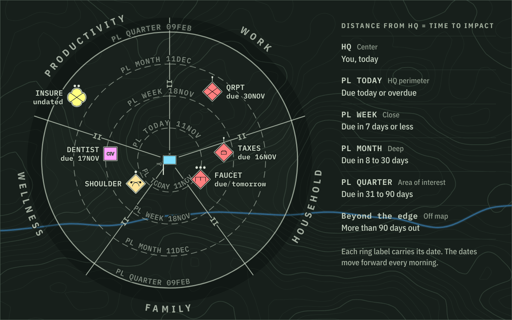

The wedges are sectors, one for each area of your life: Work, Household, Family, Wellness and Productivity on a new map. A unit's sector says what it is about; its ring says when it is due. Click a sector's name at the map edge to open its view.

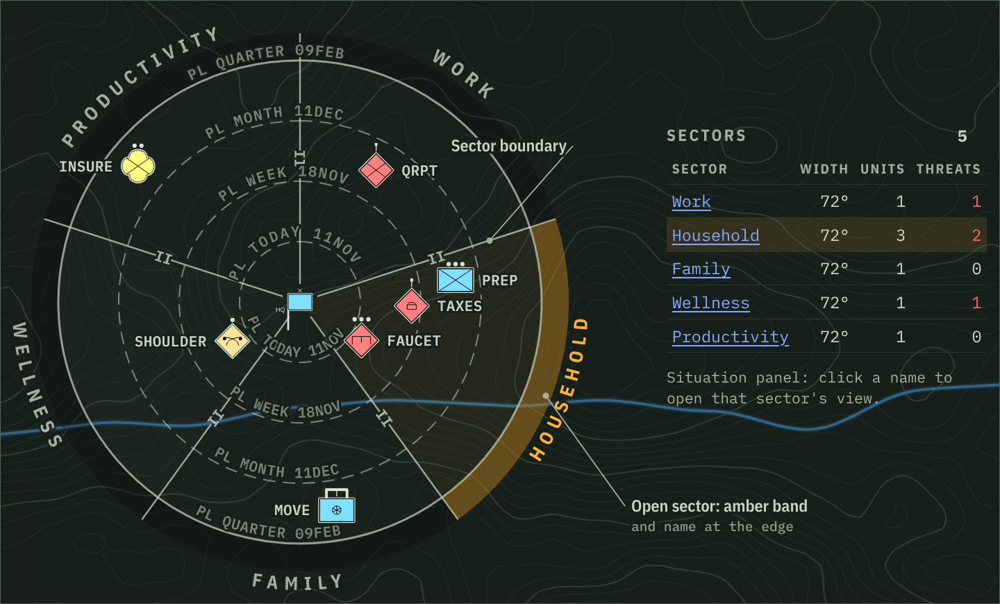

Each task, problem, person or place is a symbol. The frame shows its identity, the mark above it shows its effort (echelon, not urgency), and other marks show its status. Legend → Symbols in the app lists them all.

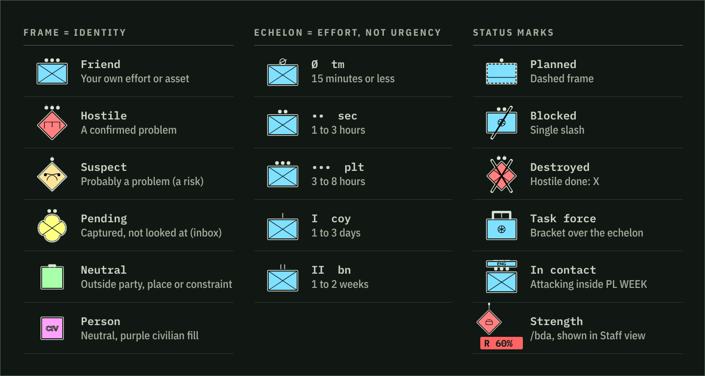

At 0400 each day the map runs its morning turn. The ring dates move forward a day, and each dated hostile or suspect moves inward to match its due date, leaving a faint trail. A hostile that crosses a phase line gets an advance order on HQ, and the order log records the turn.

## Phones, tablets and touch

Below 760 px wide (or on a touch screen under 500 px tall) the app switches to the phone layout. It has a compact top bar (DTG, live dot, online chips, menu), the map full screen, the command bar docked at the bottom above the on-screen keyboard, and one bottom sheet for the inspector, situation summary and order log (peek, half, full). From 760 to 1279 px the side columns stay and the less-used top-bar items move into the menu. The page never scrolls or zooms: the map owns its gestures (`touch-action: none`), everything else is `touch-action: pan-x pan-y`, the viewport sets `maximum-scale=1, user-scalable=no`, and iOS `gesture*` events are refused. A landscape phone gets the sheet as a right-hand column.

The bottom sheet opens and closes with one tap on its open tab or its grab bar. It reopens at the height it last had open (half at first); drag the header for any height, and tap the other tab to switch without closing.

Touch gestures on the map: drag pans, pinch zooms, double-tap on ground zooms in. Tap a unit for its card, double-tap or long-press and let go for every field, long-press then drag to move it. A second finger during a move cancels it and pinches. Drag the round handle under a selected friendly onto a hostile to attack. Long-press open ground to capture there. OBJ, EA and NAI areas move the same way (mouse: drag the outline or label). A tap or click on an area, on a phase line's ring or label, or on a sector's name at the map edge opens its view. Double-tap, double-click, right-click or long-press and let go on an area also opens its card. The standard rings and the sector wedges stay open ground. The legend's Gestures tab lists all of this.

On a phone the sheet's tab names what is open (`OBJ SETTLED IN`, `PL LAUNCH`, `SEC HOUSEHOLD`). At peek (176 px, more for a pending unit's triage chips) it shows the header, a status line and one filled and one outlined action (a unit: + Order, then Done or Destroyed); More opens it to half, where chips at the top jump to each section.

## Theme

Theme follows the system (`prefers-color-scheme`, live) unless this browser picks Day or Night; the choice is stored in `localStorage` under `opsmap.ui.theme`, never in the shared map. `public/theme-init.js` sets the theme before first paint (an external file, so the CSP needs no hash).

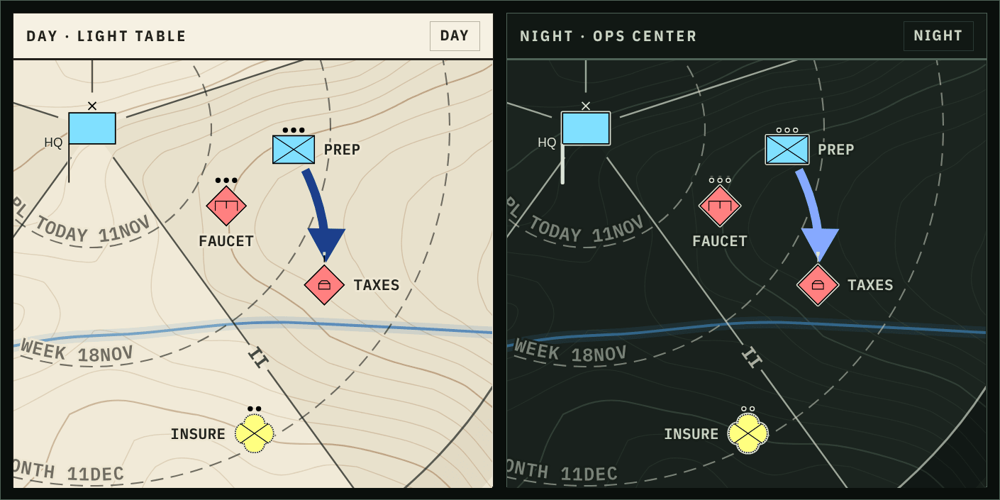

## Keyboard

The arrow keys or W A S D pan the map (Shift pans farther; WASD follows key position, so it works on any layout), `+` or `=` zooms in and `-` zooms out around the middle of the map, `0` fits it, `/` opens the command bar and Ctrl+Z / Ctrl+Shift+Z undo and redo. Map keys do nothing while you type, in menus, dialogs and lists, or in the side panels, where arrows scroll; Ctrl/⌘ combinations stay the browser's.

## Mouse and menus

On desktop, right-click on a unit opens a menu of its common actions, each with its command at the right. Attack… opens the order composer in the sidebar (Shift+click puts `/attack ‹unit› ` in the command bar instead). Move…, Due date…, Note… and Block… put the command in the command bar for you to finish. Reopen (for a done or dropped unit), Unblock, Unpin, Halt orders, key terrain, Done (Destroyed for a threat) and Drop (Bypassed) run at once and show a toast with Undo. Inspect opens the unit in the sidebar. Right-click also selects the unit. On open ground, right-click opens the capture menu, which can also start a new OBJ, EA or NAI, or a phase line, with that sector and ring filled in. An OBJ, EA or NAI gets the area's card: size, members, Open in sidebar, Join units…, Near…, Attack it… and Remove (Join units…, Near… and Attack it… open the area's view at Members, at Near, and at + Order onto…). A sector's name opens that sector's view. With a unit focused, the keyboard's menu key or Shift+F10 opens its menu; arrow keys move through it and Escape closes it. Touch keeps long-press.

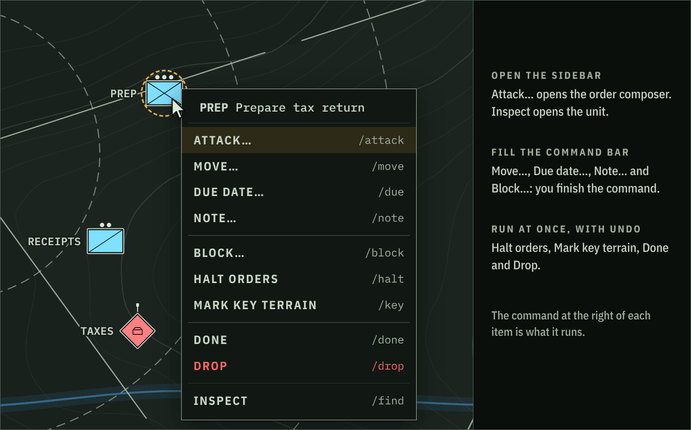

## Sidebar

The sidebar (the inspector; the bottom sheet on phones) shows whatever is selected: a unit, an area (OBJ, EA, NAI), a phase line or a sector, and the Situation summary when nothing is. `/find` opens any of them, and links inside a view (a unit's sector or area, an area's members, the units behind an order) open the next one. The chevron on a sector's map edge opens that sector at its Beyond list. A strip at the top names the kind and where it is (sector › ring), with `/CMD` and Close. Each field shows its command at the right of its label, and the line at the foot of the sidebar shows the full command of the control under the pointer, then the last command run (To bar puts it in the command bar). `/CMD` (or C with focus in the sidebar) shows every field's full command at once, and F finds the open object on the map. Every sidebar control runs the same text the command bar would, so it lands in the log and in the bar's ↑ history like a typed command. Sections open and close from their headings, and each browser remembers that per kind of view. Removing an area, phase line or sector that orders depend on asks first and names them. An area's view starts an order onto it, places it (sector, ring, near a unit, size) and joins or removes several units at once. A phase line's view says which ring its date lands in, or that it is past the map edge and not drawn. A sector's view sets its width (the other sectors scale to share the rest), lists the orders on its HQ and creates units and areas in it. The Situation view creates units, areas, phase lines and sectors and lists every sector and control measure. With Vikunja on the server, the Situation and sector views have Sync, Status, Bind and Unbind (which act on the whole map). While an area, phase line or sector is open, Commander also draws the orders onto it.

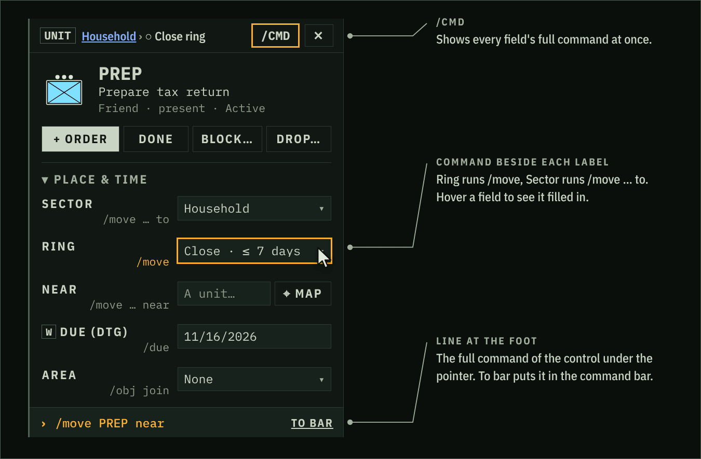

A unit's view reaches every unit command. Near, Task force (attach) and Reinforce with pick the other unit from a list ranked like the command bar's suggestions, or on the map with ⌖ Map. Reduce takes a scope cut, Due has None, and Halt stops all of the unit's orders or one kind. A function change that makes a hostile a person asks first, as identity does. **+ Order** (or N) opens the order composer in the Orders section: choose Attack, Moving, Axis, Support, Link or Advancing (a verb that does not apply is struck through and says why), a target, and the verb's options (role and planned, the phase lines an axis passes in order, a link's kind). The line under it builds the command slot by slot and shows what it will do, or the parser's error. Run (Enter) runs it; To bar (Shift+Enter) puts it in the command bar. On a phone the composer opens the sheet at full, with Run pinned at the bottom.

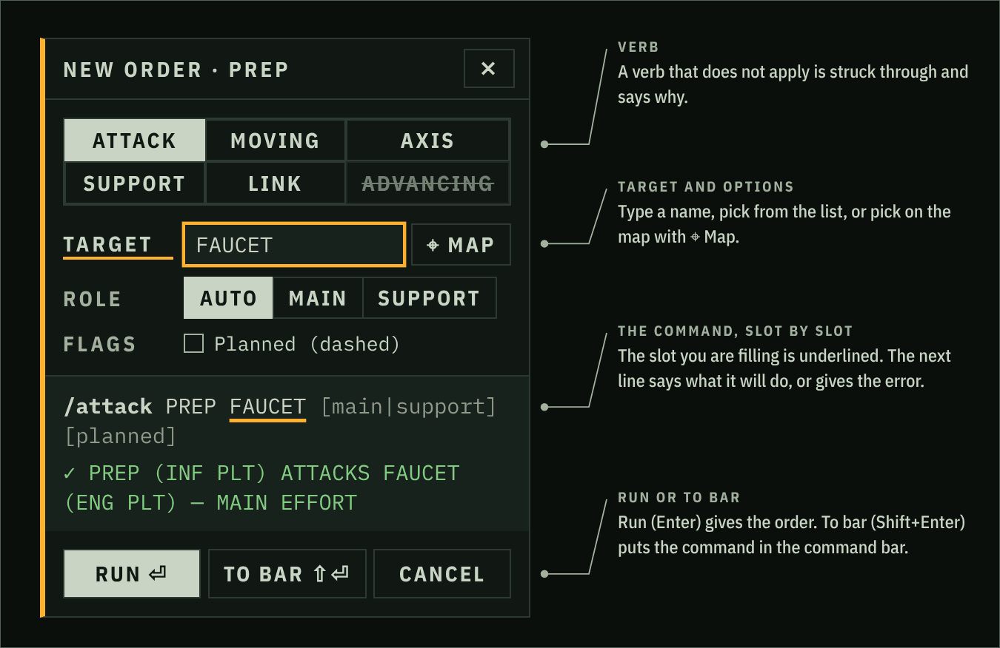

Orders can also start at the target end. An area's **+ Order onto…** and a phase line's **+ Axis via…** ask first for the friendly that gets the order, from a list ranked like the command bar's suggestions (a unit the order cannot take, such as one in another sector, is dimmed with the reason) or on the map with ⌖ Map. Then that unit's composer opens with the rest filled in: Attack with the objective as the target (Moving for an EA or NAI), or Axis with the phase line in via. An area's Near and Join units also have ⌖ Map; each pick in Join adds one unit to the selection.

Map pick: ⌖ Map next to a picker rings in amber what it can take and dims the rest; click or tap one to pick it, or Tab through them and press Enter. A banner shows the command so far, with List (back to the list) and Cancel (or Esc); on desktop and tablet it is one line just above the command bar. On a phone the sheet drops to the banner during the pick and comes back after.

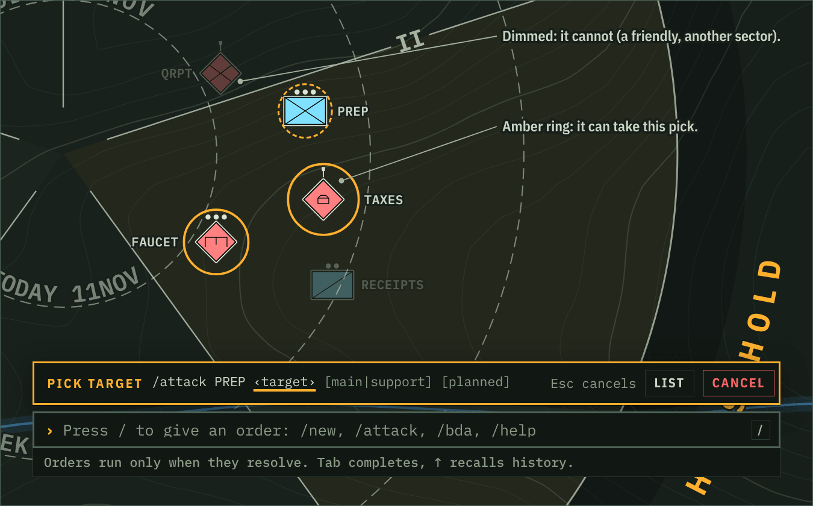

Hold a sidebar button (long-press) to see its command in a bubble without running it. F6 moves between the map, the sidebar and the command bar. N, C, F, `[` and `]` (collapse and expand every section) work only while focus is in the sidebar and not in a field; Legend → Keys lists every key and has a switch that turns these single-letter keys off.

## SITREP

`/sitrep` (or the SITREP button) gives a five-paragraph report: 1 ENEMY (hostiles and suspects inside PL WEEK, overdue ones inside HQ), 2 FRIENDLY (main efforts, blocked units, friendlies with no contact for 3+ days), 3 TERRAIN (key terrain and any threat within one ring), 4 CHANGES since the 0400 turn or the last 24 hours, 5 COMMANDER'S INTENT. Changes are a summary of what holds now, not a replay of the log: new units still open (by identity), units closed (completed, destroyed, withdrawn), orders given that still stand, control measures added or removed, phase lines crossed in the morning turn, and a count of other units updated. Something opened and dropped again, or drawn and removed again, leaves no trace. `/sitrep copy` copies the plain text.

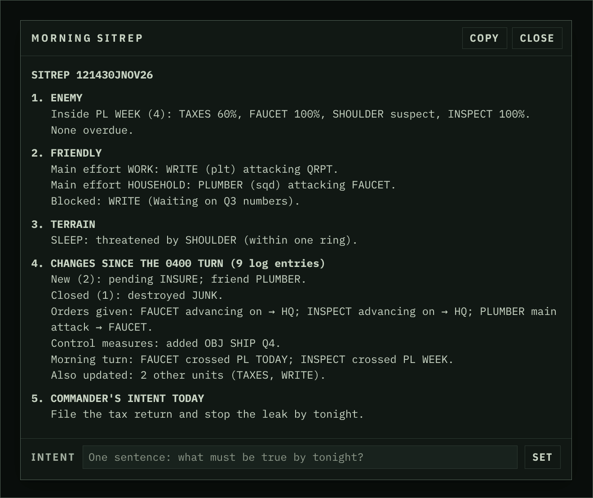

## Sound

The browser synthesizes three quiet console cues (no audio files): two rising tones for a new track (from anyone: you, another user, an agent or Vikunja), five quick beeps for a new hostile or suspect track (or one identified as hostile), and two falling tones when a hostile is destroyed. Nothing else makes a sound. Loading, reconnecting and switching maps are silent, and there is at most one cue every 1.2 seconds, so a burst of changes gives one. The speaker button in the top bar (phone: menu → Sound) mutes them; the choice is kept per browser in `localStorage` under `opsmap.ui.sound`. Browsers play sound only after a first click or key press.

## Map commands

### Control measures

`/obj|/ea|/nai move <name> [to <sector>] <hq|near|mid|far>` (the ring words `close`, `deep` and `aoi` also work everywhere) or `move <name> near <unit>`; `/pl date <name> <date>` re-dates a phase line (phase lines sit at their date and are not dragged); `/obj|/ea|/nai|/pl rename <name> "<new name>"` renames one (orders and axes on it keep pointing at it). All are ordinary undoable ops. `/find <unit>`, `/find obj|ea|nai|pl <name>` and `/find sector <name>` select the object and open its view in the sidebar; a unit or an area is also centered on the map.

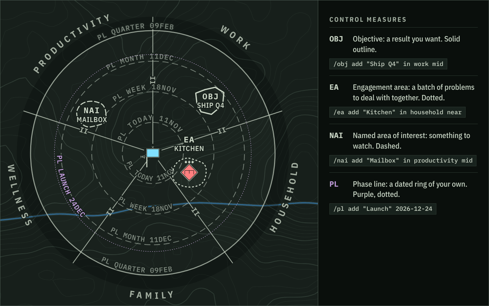

### AO size

`/ao size small|medium|large|xl` (also `/sector size`, and the AO SIZE buttons in the Situation panel) sets how much room the rings give each symbol, for the whole map and every user. Large and XL draw symbols smaller against the rings and space them closer, so a crowded band holds more; small does the reverse. Changing it places every unit again within its own sector and ring, so due dates keep their meaning, and it undoes like any other change. When a capture or move cannot get full spacing, the log adds `BAND FULL: TRY /ao size large` (or `xl`). The value is stored as `settings.aoSize` (absent means medium). `/sector width` remains the way to widen a single crowded sector.

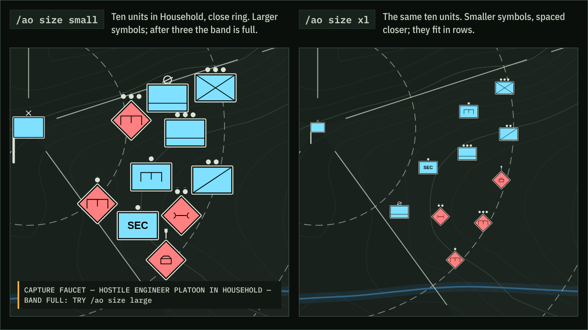

### Pins

Moving a dated unit by hand (drag, `/move`, or a sector change) pins it, and auto-advance then skips it. `/unpin <unit>` (or Unpin in the inspector) clears the pin and returns it to the ring its due date gives, in the same sector; the due date is kept. `/due <unit> <date>` also clears the pin.

### Command posts

`/cp <unit> main|tac|alt|rear` marks a unit as a headquarters of that type (the HQ staff, with MAIN, TAC, ALT or REAR in place of the icon, in every view); `/cp <unit> none` clears it, restoring its icon. The inspector has the same choice. Suggested meanings: MAIN home base, TAC where you work today, ALT the fallback, REAR errands and logistics.

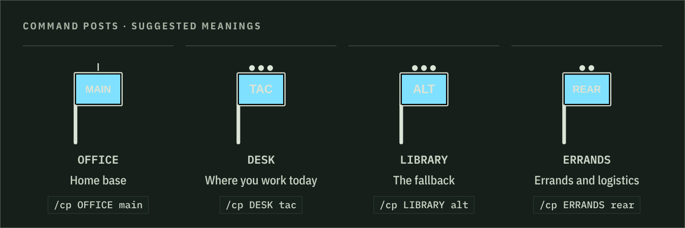

### Axis of advance

`/axis <friendly> to OBJ "<objective>" [via PL <name>[, PL <name>…]]` draws a planned broad arrow from the unit to an objective (an axis targets objectives only; another sector's objective needs a task force). With `via`, the arrow runs through each named phase line in the order given: where the straight route crosses that phase line's ring, a small checkpoint circle marks the crossing; where it does not, the arrow bends to a point on the ring part of the way across. A checkpoint that would fall under either symbol is left out. The inspector lists the phase lines with their dates (`via PL LAUNCH 26DEC`, marked `(passed)` once the date is gone), the morning turn logs `AXIS <unit>: PL <name> due today` when one falls due, and removing a phase line takes it off every axis. Autocomplete offers `to`, the objectives, `via`, then phase lines after `via` and after each comma. Axes show in Staff and Detail.

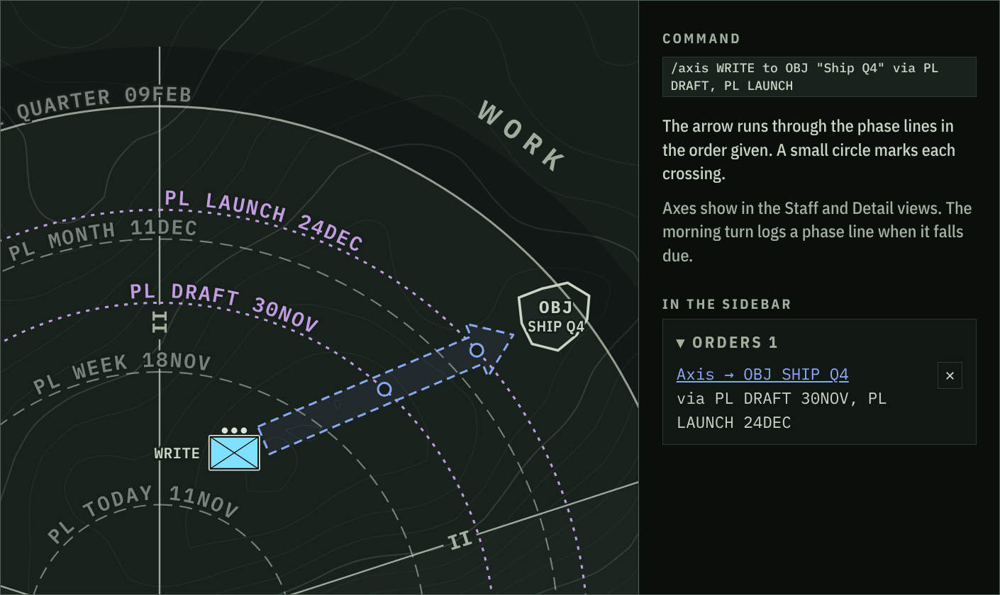

### Clearing orders

`/halt <unit>` cancels all of a unit's own orders, and `/halt <unit> advance|move|attack|axis|link` only that kind (`/stop` and `/cancel` also work); each order in the inspector has a ✕ that does the same for that one order. Undo restores them.

### Task forces

A unit becomes a task force (TF bracket) when another unit is attached to it, `/attach <unit> to <tf>`. It becomes a regular unit again when its last attached unit leaves (`/detach <unit>`, or attached to another task force); any order it held across a sector boundary is then cancelled, and the log names it (`PACKING DETACHED — TF MOVE DISSOLVED; ATTACK ON …`). Undo restores both. Only the task force itself may hold orders that cross a sector boundary, e.g. `/attack <tf> <hostile in another sector>`; its attached units may not.

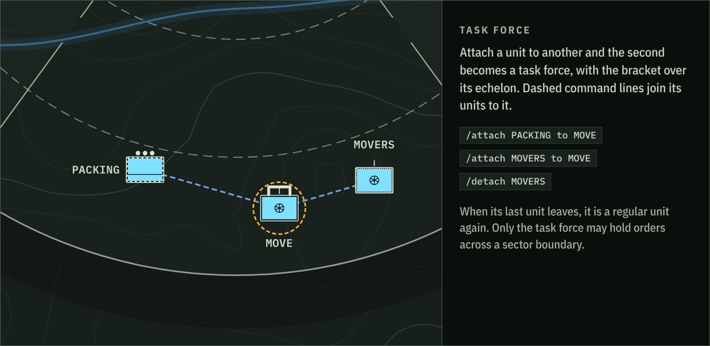

### Supporting attacks

Supporting attacks (`/attack <unit> <hostile> support`, or a second attack dragged onto a hostile that already has a main effort) draw as a thinner arrow with an open head and SPT. Staff and Detail always show them; Commander shows them when their attacker, their target or the main attacker on that target is selected.

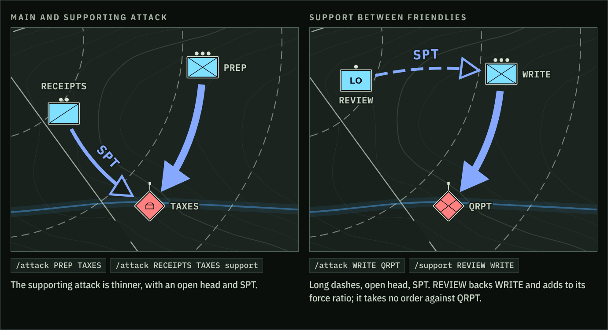

*Staff and Detail views. The right half is support between friendlies, described below.*

### Command bar suggestions

Command bar suggestions list units in this order: each command's own grouping first (for example threats first for `/bda`), then the units you last commanded or clicked in this browser tab, most recent first, then units in that unit's sector, then the most recently changed. A unit just captured with `/new` counts as used, and so does clicking a unit that is already selected. The single most recent unit comes before a command's grouping too, except in the attacker slot of `/attack` and `/moving`, which always lists friendlies first. A unit already named in the command goes last, and names that start with what you typed come first. Another user's activity does not change your order.

### Support between friendlies

`/support <unit> <engaged unit>` (alias `/spt`) has one friendly back another, in any sector, without a task force. It draws a dashed arrow with an open head and SPT from the supporter to the supported unit (Staff and Detail, or in Commander when either is selected), adds the supporter's weight to the force ratio of the attacks the supported unit makes, and is cleared with `/halt <unit> support` or the inspector's ✕. It is not an attack: the supporter takes no order against the hostile.

### Sector HQs as targets

To target a sector HQ, use `/advancing <hostile> on sector hq` (its own sector's HQ) or `on <sector> hq`, and `/moving <unit> to sector hq` for a friendly falling back. The targeted sector HQ then shows in every view. Moving the unit to another sector cancels the order; removing the sector drops it, or retargets it to the receiving sector's HQ with `reassign`. Plain `hq` is still the center.

### Headquarters of any identity

To set up a headquarters of any identity, use `/new hostile bn hq "Their legal team" as LEGAL` (or long-press open ground → New hostile HQ), `/attach <unit> to LEGAL` for each unit it controls, and optionally `/cp LEGAL main`. The HQ staff follows the symbol standard, so on a hostile diamond it hangs from the left corner rather than forming a flag. Dashed command lines join attached units to their HQ or task force, in the HQ's color: always in Staff and Detail, and in Commander for the selected HQ or member.

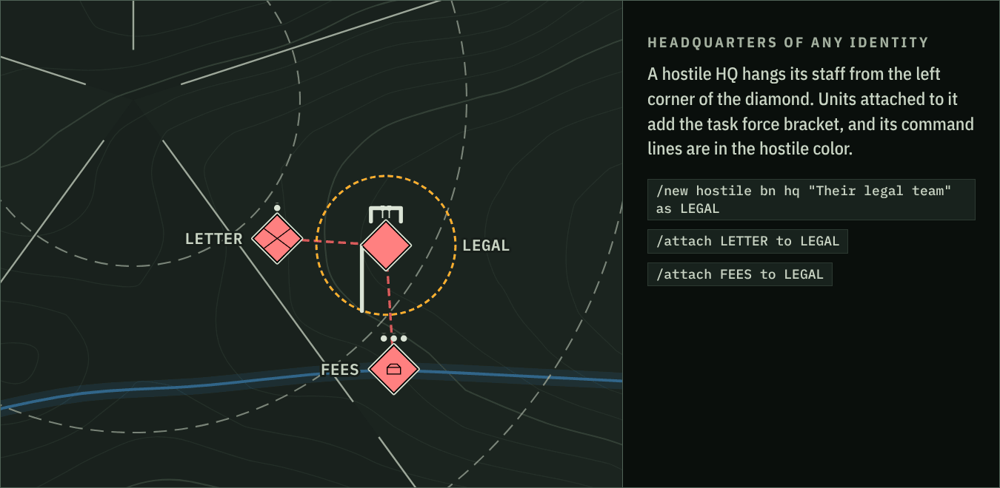

### Areas

Areas (OBJ, EA, NAI) hold units. `/ea join <name> <unit>…` moves units inside an area and `/ea leave <name> <unit>…` releases them; on the map, drop a unit inside an area's outline to add it and drag it out past the outline to remove it, or pick the area in the unit's inspector. A unit belongs to at most one area, and moving a member to another sector by command takes it out. The outline is centered on its members and grows to enclose them; `/ea size <name> small|medium|large|xl` sets the smallest it draws (medium by default, also on the area's card). Moving an area moves its members with it. The same forms work for `/obj` and `/nai`.

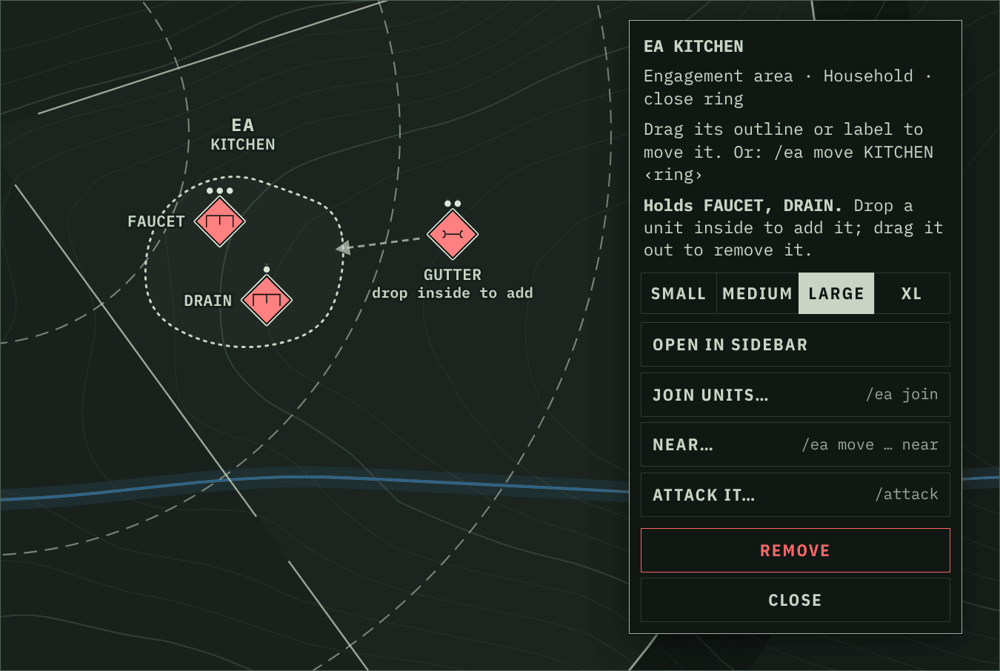

## Multiple maps

The server holds any number of shared maps (up to 50). Each map has its own op journal, sequence numbers, snapshots, undo history, presence and 04:00 morning turn; users, sessions, tokens and backups are shared, and everything stays in the one `opsmap.db`. The first map in creation order is the default. Upgrading an existing database moves its journal into the map `main`, named "Main", without changing it.

The top-bar **Map** button (the phone menu's Map section) lists the maps and opens one, and creates a new empty map (five standard sectors), duplicates the open map, creates one from an exported JSON file, or renames the open map. Any signed-in user can do these; only an administrator can delete a map, and the last map cannot be deleted. Deleting a map removes its journal (nightly backups keep earlier copies) and moves anyone on it to the default map. The open map is in the address bar as `?map=<id>` (absent for the default map) and is remembered per browser in `localStorage` under `opsmap.ui.map`. Switching waits until this map's pending changes are saved.

Command bar: `/map` lists the maps in the result line, and `/map <name>` (or its id) opens one, with the map names offered as you type. `/help <verb>` (or an alias) puts that verb's syntax in the result line and opens the legend's command list. MCP has the same management tools; see below.
